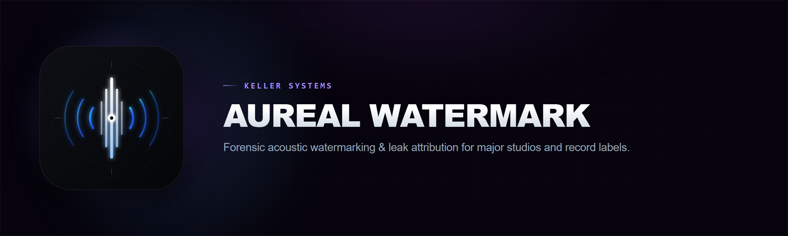

<div align="center">



<br>

[](https://github.com/KELLERBABG/Aureal-Watermark/releases/latest)
[](https://aureal.kellersystems.dev)
[-0891b2?style=flat-square)](docs/TECHNICAL_SPECIFICATIONS.md)
[](https://aureal.kellersystems.dev/pricing.html)

<br>

[**Launch Web Studio**](https://aureal.kellersystems.dev/studio) &bull; [**Commercial Licensing & Pricing**](https://aureal.kellersystems.dev/pricing) &bull; [**Documentation**](https://aureal.kellersystems.dev/docs) &bull; [**Technical Specifications**](docs/TECHNICAL_SPECIFICATIONS.md)

</div>

---

## What is Aureal Watermark?

**Aureal Watermark** embeds a 32-bit identifier into audio using spread-spectrum signal processing. The watermark is designed to be subtle, and the scanner attempts to recover the identifier after supported transformations. Recovery depends on the source audio, codec, and processing.

> **Important limitation:** A matching watermark is a provenance signal, not cryptographic proof of authorship, ownership, or when a file was created. Anyone with access to the software and matching key can generate a matching ID. Retain independent source, recipient, and custody records; this tool is not a substitute for cryptographic signing or a complete provenance system.

---

## Why Use It?

* **Audio Leak Investigation:** Give each listener or preview recipient a unique watermark ID, then check recovered IDs against your distribution records when investigating a leak.
* **Codec Resilience Testing:** Detection has been tested on selected MP3/AAC transcodes and signal transformations; recovery depends on the source audio, codec, and processing.
* **Local Audio Processing:** The DSP embed/detect workflow runs locally. Optional commercial-license activation makes a network request to Polar.sh.

---

## How It Works (In Plain English)

```
[ Your Audio File ] ──► [ Embed Invisible ID (#883921) ] ──► [ Protected Audio ]
                                                                     │
                                                    (Designed to remain subtle; audibility varies by material and playback)
                                                                     │
                                       Later: Someone uploads or leaks your file
                                                                     │
                                                                     ▼
                                                     [ Scan with Aureal Watermark ]
                                                                     │
                                                                     ▼
                                                   "Recovered watermark ID #883921"
```

1. **Pick an ID number:** Choose any serial number (like `#883921` or a recipient's code).
2. **Protect the file:** Aureal embeds the number into subtle frequency layers of your audio.
3. **Audio remains usable:** Embedding is designed to be subtle; audibility may vary with audio material, settings, and playback.
4. **Scan a copy:** Drop supported audio into Aureal to check whether an ID can be recovered. Use independent records to establish ownership and provenance.

---

## Easy Ways to Use It

### Option 1: Standalone Desktop Studio & Windows Executable (Recommended)

1. Download **[`aureal-watermark.exe`](https://github.com/KELLERBABG/Aureal-Watermark/releases/latest/download/aureal-watermark.exe)** from the Releases page.
2. Double-click to launch the offline **Desktop Studio Application**:
   * **Multi-Format Audio Export:** Download masters in WAV 16-bit, WAV 24-bit, or MP3 (320k, 192k, 128k) with built-in offline LAME encoding.
   * **Collision pre-check:** on upload, warns when a master already carries a detectable watermark (with the key you enter). It is advisory — embedding is not blocked, and it cannot see a watermark made with a different key.
   * **Cryptographic Auto-ID:** 1-click generation of random tracking IDs and studio namespace keys.
   * **Local Audio Processing:** DSP runs on-device; license activation may contact Polar.sh.

You can also run it directly via CLI or command prompt:
```bash
# Launch GUI Studio (Default)
./aureal-watermark.exe

# Or run headless CLI operations
./aureal-watermark.exe embed master.wav protected.wav --id 883921
./aureal-watermark.exe detect protected.wav --id 883921
```

---

### Option 2: Web Studio (In Your Browser)

No installation or technical setup needed:

**[Launch Interactive Web Studio &rarr;](https://aureal.kellersystems.dev/studio)**

*(Audio processing runs in your browser. Optional license activation contacts Polar.sh).*

---

### Option 3: Standalone Universal Script (Cross-Platform CLI)

A single, zero-dependency file that runs on **Windows, macOS, and Linux** using standard Node.js (&ge; 18). Supports direct input and output of **MP3, FLAC, AAC, M4A, OGG, AIFF, and WAV** with automatic FFmpeg fallback:

1. Download **[`aureal-watermark.cjs`](https://github.com/KELLERBABG/Aureal-Watermark/releases/latest/download/aureal-watermark.cjs)** from the Releases page.
2. Run from your terminal or command prompt:

```bash
# 1. Embed an ID directly into an MP3, FLAC, or WAV
node aureal-watermark.cjs embed master.wav protected.mp3 --id 883921

# 2. Check an audio file to see if it contains your ID
node aureal-watermark.cjs detect protected.mp3 --id 883921

# 3. Blind scan (automatically extracts any embedded ID from an unknown file)
node aureal-watermark.cjs detect mystery_audio.mp3 --json

# 4. Generate a cryptographically sealed forensic audit proof
node aureal-watermark.cjs detect leak.mp3 --id 883921 --report proof.json --report-txt cert.txt

# 5. Launch your local offline Desktop Studio
node aureal-watermark.cjs gui
```

---

### Option 4: Air-Gapped Docker REST Microservice (For Cloud & Speech Pipelines)

Deploy an air-gapped, zero-dependency HTTP REST daemon on Kubernetes, AWS ECS, or Nomad in 1 command:

```bash
# Launch with Docker Compose
docker compose -f docker/docker-compose.yml up -d
```

The daemon runs rootless on port `8080` with an in-memory `tmpfs` volume:

```bash
# 1. Liveness & Engine Health Probe
curl -s http://localhost:8080/v1/health

# 2. Embed via raw binary stream (WAV, MP3, FLAC)
curl -X POST "http://localhost:8080/v1/embed?id=883921&strength=0.5&band=dual&format=mp3" \
  -H "Content-Type: audio/wav" \
  --data-binary @master.wav \
  --output protected.mp3

# 3. Detect via raw binary stream
curl -X POST "http://localhost:8080/v1/detect?id=883921&report=true" \
  -H "Content-Type: audio/mpeg" \
  --data-binary @protected.mp3
```

Also accepts JSON bodies with base64 audio payloads (`{ "audioBase64": "...", "id": 883921 }`).

---

### Option 5: Watermark Detection Audit Report

Export a report with hashes of the analyzed file, detection metrics, and an HMAC integrity seal that covers **the entire report body** (verdict, payload ID, metrics, file hashes). Anyone holding the same key can re-check it, so tampering with any field is detectable:

```bash
auralwatermark detect evidence.mp3 --id 883921 --report proof.json --report-txt cert.txt
auralwatermark verify-report proof.json --key <same key>   # exit 0 = seal valid, 1 = modified/wrong key
```

The HMAC uses the supplied key (or a built-in default). It is a shared-secret MAC, not a public-key signature: it shows the report was produced by someone with the key and has not been altered since, but on its own it does not establish authorship, scan time, chain of custody, or legal admissibility.

#### Illustrative Sample Output (`cert.txt`):
```text
==============================================================================
              AUREAL WATERMARK — DETECTION AUDIT REPORT               
                 Watermark ID Matching Results                        
==============================================================================
Date/Time (UTC) : 2026-09-11T09:12:10.476Z
Engine          : Aureal Watermark DSP Engine v0.2.7
Report Schema   : v1.1.0
------------------------------------------------------------------------------
1. TARGET EVIDENCE FILE
   Path         : evidence.mp3
   Size         : 264,644 bytes
   SHA-256      : 7dafa0b0c58327ed539a87b78ead6c632007b9dff869849489bef82b2cb1c293
   SHA-512      : 82b16b5068978739e3fbb5d4e1a11a7bcb14100342f5b2f1...
------------------------------------------------------------------------------
2. WATERMARK DETECTION RESULT
   Result       : [WATERMARK_ID_MATCH]
   Detected     : YES
   Payload ID   : 883921
   Expected ID  : 883921 (Match: PASS)
   Confidence   : 100.0%
   Bit Error Rate: 0.00%
   CRC Integrity: VALID (OK)
------------------------------------------------------------------------------
3. PHYSICAL-LAYER DSP METRICS
   Eb/N0        : 13.93 dB
   SQNR         : 16.94 dB
   Z-Score      : 32.87
   Carrier Band : 17000 - 19500 Hz
   Sync Method  : preamble
------------------------------------------------------------------------------
4. REPORT INTEGRITY SEAL (shared-secret HMAC, not an identity signature)
   Algorithm    : HMAC-SHA256
   Covers       : entire report body except this signature object
   Seal Hash    : 9702c8625046347512fe23df534257be752512a650fd8ed072b6aa90d814356b
   Verify with  : auralwatermark verify-report <file> --key <secret>
==============================================================================
Note: A watermark match is not proof of authorship or legal attribution.
==============================================================================
```

---

### Option 6: JavaScript & TypeScript API (With First-Class `.d.ts` Types)

Integrate protection directly into your Node.js or TypeScript applications:

```typescript
import {
  embedWatermark,
  detectWatermark,
  generateForensicReport,
  readWavFile,
  writeWavFile
} from "aureal-watermark";

// Load audio file
const wav = await readWavFile("song.wav");
const format = { sampleRate: wav.sampleRate, channels: wav.channels };

// Embed watermark ID #883921
const protectedAudio = embedWatermark(wav.samples, format, { payloadId: 883921 });
await writeWavFile("song_protected.wav", protectedAudio, { ...format, bitDepth: 16 });

// Scan and verify
const result = detectWatermark(protectedAudio, format, { payloadId: 883921 });

console.log(result.detected);           // true
console.log(result.confidence);         // 1.0 (100%)
console.log(result.ebN0Db);             // +14.2 dB (Signal-to-Noise)
console.log(result.recoveredPayloadId); // 883921
```

---

## Testing & Reproducibility

```bash
npm test                      # node --test: 133 tests with ffmpeg, 123 without (codec tests skip)
npm run sync:site:check       # fails if any page alias or the generated browser engine has drifted from src/
npm run build:engine          # regenerate assets/aureal-engine.js after changing src/
```

The suite covers the payload/CRC layer, WAV I/O, the embed/detect round-trip and band handling, the forensic seal and its verification, the CLI contract, the REST microservice, the browser engine (generated from `src/`, so the CLI and the Web Studio cannot diverge) and the batch-distribution/leak-audit scripts.

`audit/` additionally holds the adversarial-fixture and codec/transcode scripts used for the survival table below; those are measurement tools, not part of CI.

---

## Regulatory and C2PA Context (Not a Compliance Claim)

### 1. EU AI Act Article 50 Machine-Readable Synthetic Audio
Article 50 of the European Union AI Act establishes transparency obligations for certain providers and deployers of AI systems. This project does not provide a legal compliance determination or guarantee that its watermark meets those requirements.
* **Metadata limitations:** Audio services may strip or transform metadata during re-encoding.
* **Aureal's role:** Aureal embeds a keyed 32-bit identifier in audio; recovery depends on the source, encoder, and processing. The ID does not itself establish the identity, origin, or authenticity of content.

### 2. The C2PA Content Credentials Persistence Bridge
Aureal's 32-bit ID can be used as an application-level lookup value alongside independently maintained provenance records. Aureal does not create, validate, or recover a C2PA manifest; the repository example is illustrative, not a certified C2PA implementation.

---

## Operational Capabilities & Adversarial Attack Resistance

Aureal is exercised against a local adversarial fixture suite. Results are limited to the fixtures listed here and do not establish universal performance across all content, devices, or services:

| Transformation / Attack Vector | Survives? | Empirical Result & Engineering Notes |
| :--- | :---: | :--- |
| **Selected Multi-Generational Lossy Transcode**<br>*(Test fixture: WAV &rarr; MP3 128k &rarr; AAC 96k &rarr; MP4 &rarr; MP3 64k &rarr; Opus 96k &rarr; WAV)* | **Tested** | Passed in the current local ffmpeg test run. Results vary by source material, encoder, and transformations; this does not establish compatibility with every social platform. |
| **Mid/Side Subtraction (L - R fixture)** | **YES** | Detected in the local fixture only. Orthogonal Mid/Side channel decorrelation ($W_L = \frac{M+S}{\sqrt{2}}, W_R = \frac{M-S}{\sqrt{2}}$) Tested on a synthetic side-channel fixture; results depend on source content and transformation. |
| **Phase-Inversion Downmix Fixture** | **Tested** | The local synthetic fixture passed; behavior depends on the source mix and transformation. |
| **Stereo-to-Mono Downmix Fixture** | **YES** | Detected in the local fixture only. In-phase Mid component reconstructs with $+3\text{ dB}$ signal gain. |
| **Short Snippet Crop** | **Partial** | A 1.8 s excerpt is recovered for roughly half of all start offsets on a 12 s test file (measured 49/93 offsets); 1.0 s ≈ 50 %, and anything shorter than one frame (~1 s at 44.1 kHz) is never recovered. Longer files and aligned excerpts do better. |
| **Playback Speed & Pitch Drift ($\pm1.0\%$)**<br>*(Analog tape wow/flutter, speed stretch)* | **YES** | Detected in local resampling fixtures; no general analog wow/flutter guarantee. |
| **Low-Pass Filtering** | **Partial** | Which cutoff survives depends on the fixture: on a 12 s stereo test file a 16 kHz low-pass *lost* the dual-band watermark while 12 kHz and 7 kHz recovered it (the mid-band carrier is what survives). In general, filtering that removes energy below the mid carrier erases the watermark. |
| **High-Pass / Notch Fixtures (1 kHz / 18 kHz)** | **Tested** | The local synthetic fixtures passed; source-specific filtering can still remove the watermark. |
| **Air-Gap Recording (Speaker to Mic)** | **Tested** | Detected in one local room-reverb simulation; this does not establish phone or room recording performance generally. |
| **Extreme Overdrive (+12 dB hard clipping)** | **Tested** | Detected in the local synthetic fixture; results depend on content and processing. |
| **Heavy Broadcast Compression & Limiting** | **Tested** | Detected in one local compressor fixture; results vary with audio and settings. |
| **Additive Background Noise (-20 dB fixture)** | **Tested** | Detected in the local pink-noise fixture; results vary with signal-to-noise ratio and content. |
| **Sample-Rate Conversion Fixtures** | **Tested** | Selected conversion tests passed; results depend on converter quality and source audio. |
| **Multi-Layer Watermarking** | **Tested** | Distinct-key watermark layers were detected in the local synthetic fixtures; this limited result is not a general coexistence guarantee. |
| **Coalition Collusion (2–5 leakers averaging copies)** | **NO** | **Known limitation.** Each copy carries a single payload ID, so averaging enough independently tagged copies cancels it and recovery fails. No collusion-resistant fingerprint layer is implemented; `src/tardos.js` contains only a standalone Tardos *scoring* utility that the pipeline does not feed. |
| **Re-embedding with Same Key, Different ID** | **Not reliable** | Current local tests show neither the original nor replacement ID is reliably detected after re-embedding. Treat this as a known limitation; do not claim overwrite protection. |

---

## Deep Dive & Technical Documentation

For audio engineers, DSP researchers, and developers who want to inspect the mathematics, frequency bands, and algorithms:

* [**Commercial Licensing & Enterprise SLA**](docs/COMMERCIAL_LICENSING.md) — Production licensing terms, pricing tiers, and compliance specifications.
* [**Technical Specifications & Benchmarks**](docs/TECHNICAL_SPECIFICATIONS.md) — DSSS carrier frequencies, BPSK modulation parameters, and measured compression tests.
* [**Codebase Wiki**](docs/CODEBASE_WIKI.md) — Complete file-by-file reference for every function and DSP module.
* [**Whitepaper**](docs/WHITEPAPER.md) — Formal threat model, detection statistics, and academic background.
* [**System Architecture**](docs/ARCHITECTURE.md) — Signal processing pipelines and audio data flow.
* [**Payload Wire Format**](docs/PAYLOAD-FORMAT.md) — 48-symbol codeword specification and CRC-16 checksums.

---

## Commercial Licensing & Enterprise SLA (confirm current offer before publishing)

Aureal Watermark is distributed under a **Dual License**:

* **Personal, Academic & Hobby Use:** Free under the [PolyForm Noncommercial License 1.0.0](LICENSE.md) — source-available, not OSI open source.
* **Commercial & Enterprise Use:** A commercial production license is required for commercial releases, label promo pools, SaaS audio pipelines, and AI speech platforms.

### Commercial Pricing Matrix

| Tier | Price | Includes |
| :--- | :--- | :--- |
| **Non-Commercial / Evaluation** | **Free** | Academic and personal evaluation, 100% offline CLI and Web Studio. |
| **Creator Studio** | **€9 / mo** *(or €89 / yr)* | Unlimited commercial track releases, standalone CLI, offline Web Studio, permanent watermark survival. |
| **Promo Leak Suite / Label** | **€29 / mo** *(or €290 / yr)* | Batch promo pool distribution with a private recipient manifest, one-click leak audit (`scripts/audit_leak.js`), priority support. Collusion-resistant fingerprinting is **not** included. |
| **Platform & API** | **Custom / Enterprise** | Headless Node.js backend integration rights, Docker REST microservice, automated export hook SLA. |

For current commercial subscriptions, checkout availability, and terms, confirm the [**Interactive Pricing Page**](https://aureal.kellersystems.dev/pricing), consult [**docs/COMMERCIAL_LICENSING.md**](docs/COMMERCIAL_LICENSING.md), or contact **[business@kellersystems.dev](mailto:business@kellersystems.dev)**.

